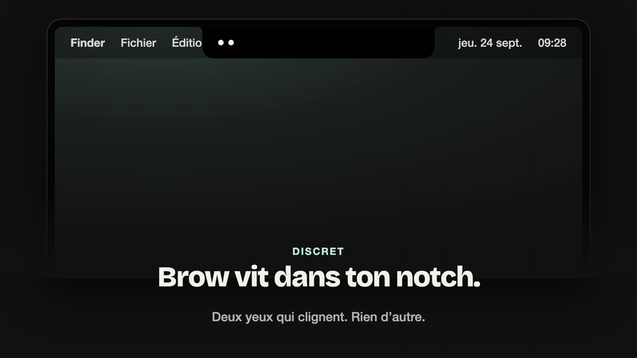

<div align="center">



# Brow

### L'assistant de réunion qui vit dans ton notch.

Il te prévient avant tes réunions, les enregistre, les transcrit **sur ton Mac**<br>
et te rend un résumé clair : décisions, actions, sujets.

<br>

<a href="https://github.com/marshallino16/brow-releases/releases/latest/download/Brow.dmg">
  
</a>

<br><br>

[](https://github.com/marshallino16/brow-releases/releases/latest)


<br>

<a href="assets/brow-presentation.mp4">
  
</a>

<sub>▶︎ <a href="assets/brow-presentation.mp4">Voir la vidéo complète (1 min)</a></sub>

</div>

<br>

## Un sourcil, deux yeux, zéro friction

Brow est un petit personnage installé dans l'encoche de ton Mac. Au repos, il ne prend que deux yeux de place. Quand une réunion approche, il lève le sourcil.

<table>
<tr>
<td width="33%" valign="top">

#### ⏰ Avant

**30 min avant**, une pastille discrète : « Point produit · 12 min ».
**2 min avant**, le panneau s'ouvre tout seul : participants, lien de visio, bouton **Enregistrer**.

</td>
<td width="33%" valign="top">

#### ● Pendant

Ta voix (micro) et celle des autres (audio système) sur **deux pistes**, sans jamais enregistrer l'écran. Pause, reprise, une onde qui bat dans le notch.

</td>
<td width="33%" valign="top">

#### ✦ Après

Transcription **locale**, séparation des locuteurs, puis un résumé : **décisions**, **actions** (qui · quoi · quand), **sujets**. Prêt quand tu raccroches.

</td>
</tr>
</table>

## Ce qu'il sait faire

|  |  |
|---|---|
| 🎙️ **Enregistrement local** | Micro + audio système via un tap Core Audio. Le micro reste celui de ton Mac, même si tu partages ton écran en AirPlay. |
| 🧠 **Transcription 100 % sur le Mac** | Parakeet sur le Neural Engine, reconnaissance des voix que tu as enregistrées. L'audio ne quitte jamais ton Mac. |
| ✍️ **Résumé par Claude** | Via ton [Claude Code](https://claude.com/claude-code) local, avec un prompt que tu peux modifier. Schémas Mermaid quand ça aide. |
| 🗂️ **Tes notes, rangées** | Une fenêtre Notes avec recherche plein texte et groupes (1-1, COMEX…). Les réunions récurrentes se rangent seules. |
| 📅 **Google Agenda** | Lecture seule : titres, horaires, participants et liens de visio de tes réunions. |
| 📝 **Notion** | Chaque résumé copié automatiquement dans la base de ton choix. |
| 🔌 **Tes réunions dans Claude** | Un serveur MCP : « Qu'a-t-on décidé au dernier COMEX ? », « Quelles actions me restent ? » |
| 🎨 **À ton goût** | Sombre ou clair, 10 couleurs d'accent, français ou anglais. Un panneau flottant sur les écrans sans encoche. |

Chaque réunion est un simple fichier **Markdown** dans `~/Meetings` : lisible, versionnable, à toi.

## Installer

> [!NOTE]
> Il faut **macOS 14.4 ou plus récent** et un Mac **Apple Silicon** (M1 et suivants).

1. **[Télécharge Brow.dmg](https://github.com/marshallino16/brow-releases/releases/latest/download/Brow.dmg)**, ouvre-le, glisse **Brow** dans **Applications**.
2. Lance Brow depuis Applications. Il est signé Developer ID et notarisé par Apple : macOS te demande juste confirmation au premier lancement.
3. Laisse-toi guider par l'onboarding : couleur, permissions, modèles de transcription (~1 Go, une seule fois), Claude Code, Google Agenda.

### Les permissions, et pourquoi

| Permission | Pour quoi faire | Obligatoire |
|---|---|:---:|
| **Micro** | Enregistrer ta voix pendant les réunions | ✅ |
| **Enregistrement des sons du système** | Entendre les autres participants (audio uniquement, jamais l'écran) | ✅ |
| **Google Agenda** | Te prévenir avant tes réunions, nommer les participants | — |
| **Claude Code** | Rédiger les résumés | — |
| **Notion** | Copier les résumés dans ton espace | — |

## Mises à jour automatiques

Brow se met à jour tout seul. Il vérifie une fois par jour, et tu peux aussi le faire depuis **Réglages › Général › Rechercher les mises à jour…**

- 🛡️ **Jamais pendant une réunion.** Pas de vérification pendant un enregistrement ou sa transcription, et une installation attend la fin du meeting pour relancer l'app.
- 🔏 **Signées de bout en bout.** Chaque version est signée Developer ID, notarisée par Apple, et signée EdDSA : Brow refuse toute mise à jour qui ne vient pas de nous.
- 🔐 **Tes permissions sont conservées** d'une version à l'autre.

Historique des versions : **[Releases](https://github.com/marshallino16/brow-releases/releases)**.

## Interroger tes réunions depuis Claude

```sh
claude mcp add brow -- /Applications/Brow.app/Contents/MacOS/browmcp
```

La commande est aussi dans **Réglages › Avancé › Copier**. Claude peut alors :

| Outil | Ce qu'il fait |
|---|---|
| `list_meetings` | Les réunions d'une période, d'un participant, d'un groupe |
| `search_meetings` | Recherche plein texte dans les transcriptions et résumés |
| `get_meeting` | Une réunion complète : résumé, décisions, actions, transcription |
| `list_action_items` | Les actions ouvertes ou faites, par personne |

## Confidentialité

| Reste sur ton Mac | Sort de ton Mac |
|---|---|
| L'audio, toujours | La **transcription**, envoyée à Claude via ton Claude Code pour le résumé |
| La transcription et les empreintes de voix | Le résumé, vers Notion **si tu l'as connecté** |
| Tes notes (`~/Meetings`) et l'index de recherche | |

Les jetons Google, Notion et Anthropic sont dans le **Trousseau** macOS. Aucune télémétrie, aucun serveur Brow.

## Questions fréquentes

<details>
<summary><b>Mon Mac n'a pas d'encoche (ou j'utilise un écran externe)</b></summary>
<br>
Brow s'affiche alors dans un panneau flottant en haut de l'écran, avec exactement les mêmes états.
</details>

<details>
<summary><b>Je présente mon écran en AirPlay pendant la réunion</b></summary>
<br>
Le micro reste celui avec lequel l'enregistrement a commencé. Brow ne suit pas le changement de micro par défaut que macOS fait en connectant un écran AirPlay. Si le micro disparaît vraiment (AirPods rangés), il bascule et te le signale. S'il n'entend plus rien pendant 10 s, il te prévient aussi.
</details>

<details>
<summary><b>Puis-je enregistrer une conversation hors agenda ?</b></summary>
<br>
Oui : balaie les cartes du panneau jusqu'à « Conversation libre », ou utilise <code>⌘R</code> depuis le menu.
</details>

<details>
<summary><b>Désinstaller Brow</b></summary>
<br>
Quitte Brow et mets-le à la corbeille. Tes notes restent dans <code>~/Meetings</code>. Les modèles de transcription sont dans <code>~/Library/Application Support/</code> si tu veux libérer la place.
</details>

<br>

<div align="center">
<sub>Ce dépôt ne contient que les versions publiées de Brow : DMG et flux de mises à jour (<code>appcast.xml</code>).<br>Fait avec soin, et un sourcil levé.</sub>
</div>
